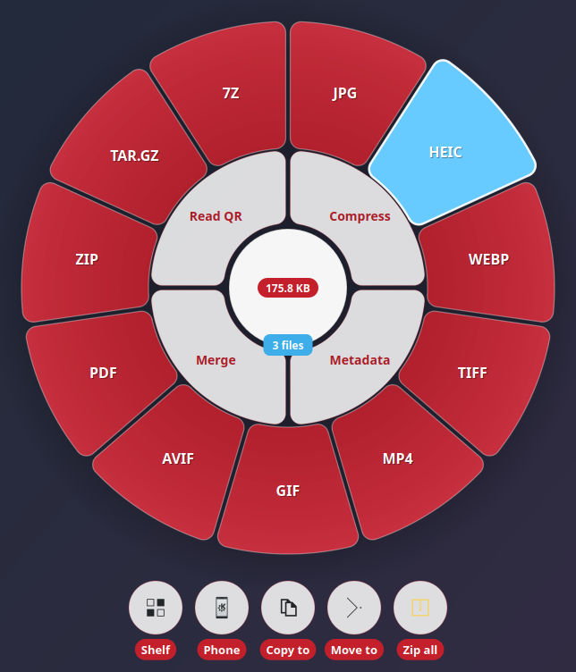
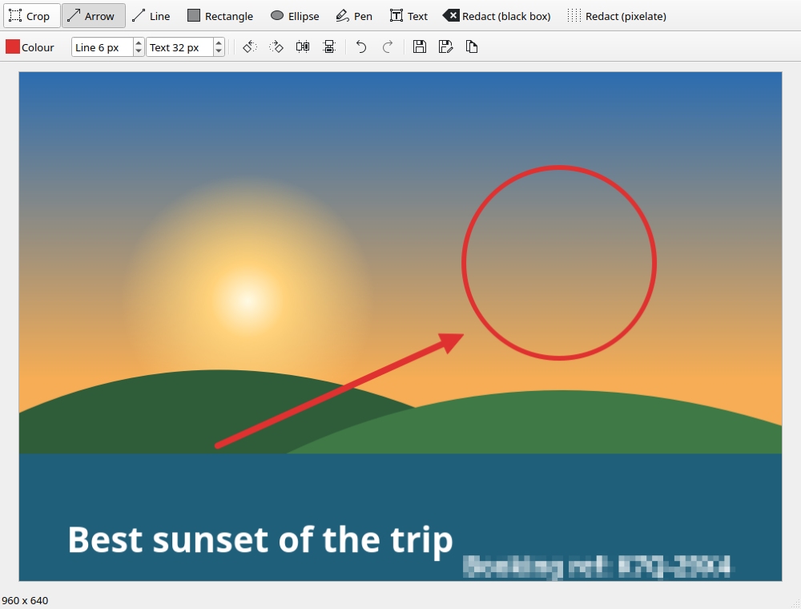
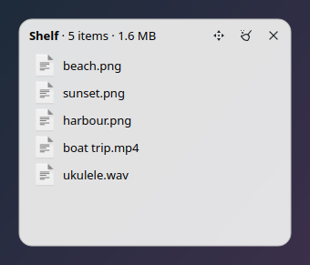
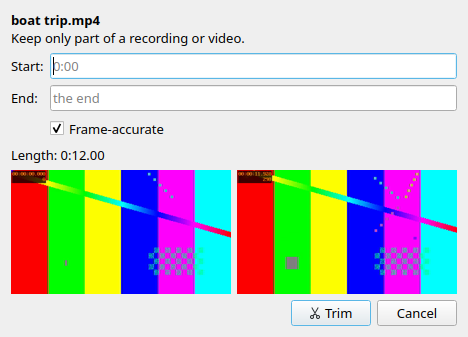
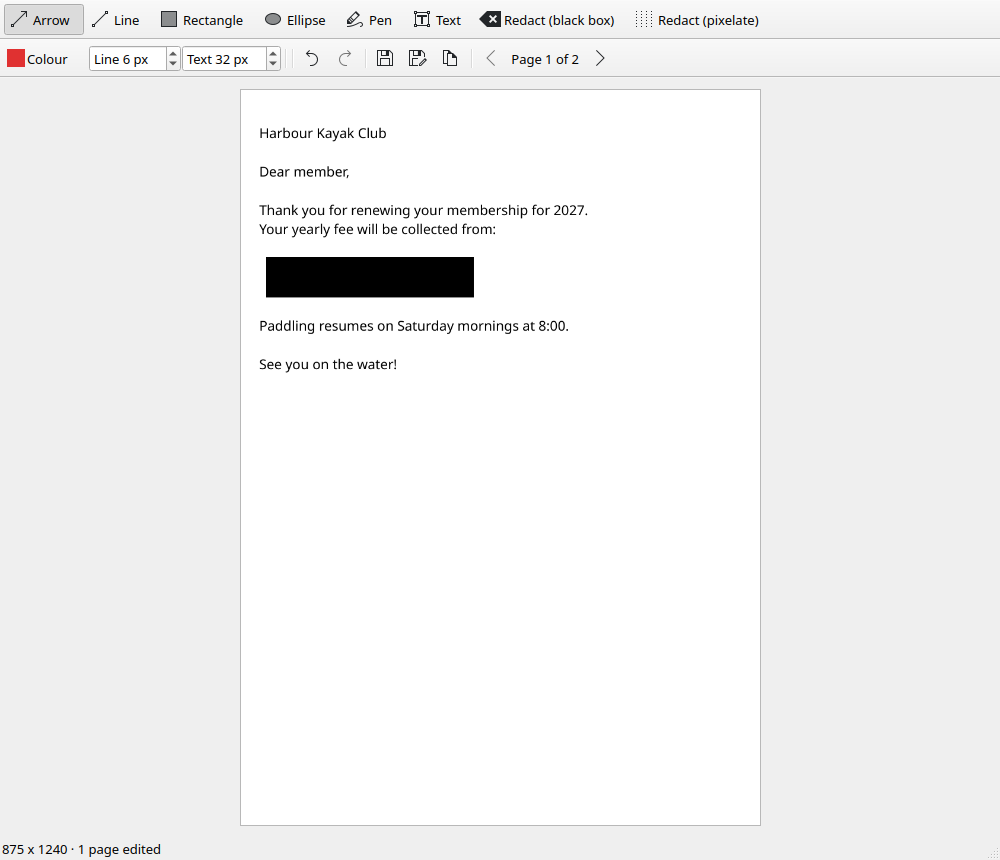

# Hala

[](https://github.com/baverrr/hala-v2/actions/workflows/codeql.yml)
[](LICENSE)

A file converter for Linux desktops, made on KDE Plasma. Drag files to the edge of the screen, pick a format on a wheel, and the results appear next to the originals. Nothing is uploaded anywhere.

<p align="center">
  
</p>

> [!TIP]
> No need to drag. Copy files with Ctrl+C and press **Meta+Shift+H**, or right-click them in Dolphin and pick **Hala…**. The same wheel opens where the pointer is.

> [!IMPORTANT]
> Hala is provided as is, at your own risk (see the [Terms](TERMS.md)). It never overwrites the original, but conversions can lose quality or formatting, and **Move to** removes files from their old place. Check redactions and metadata before sharing a file.

**[What it does](#what-it-does)** · **[What you need](#what-you-need)** · **[Install](#install)** · **[How to use it](#how-to-use-it)** · **[Help](#help)**

## What it does

- **Converts by dragging.** Drop files on a petal of the wheel. It only shows formats the files can become. Around 70 input formats: pictures, video, audio, subtitles, office files, Markdown, e-books, PDF and archives.
- **Adds tools.** Compress to a size, remove metadata, merge, split and unlock PDFs, read QR codes, even out loudness, and trim, split or join video and audio.
- **Edits pictures and PDFs.** Crop, rotate, draw arrows, shapes and text, and black out or pixelate parts. It always saves a copy.
- **Holds files on a shelf.** A small floating window keeps files until you drag them somewhere else.
- **Sends and moves files.** Send to your phone with KDE Connect, copy or move to a folder, or zip them all.
- **Stays on your computer.** It uses ffmpeg, libvips, LibreOffice, pandoc and other local programs. It speaks English, German, Spanish, French and Brazilian Portuguese.

<table>
  <tr>
    <td></td>
    <td></td>
  </tr>
  <tr>
    <td align="center">The picture editor</td>
    <td align="center">The shelf</td>
  </tr>
  <tr>
    <td></td>
    <td></td>
  </tr>
  <tr>
    <td align="center">Trimming a video</td>
    <td align="center">Redacting a PDF</td>
  </tr>
</table>

## What you need

- Kubuntu 25.04 or later, or Ubuntu with KDE Plasma 6 (Wayland). It is tested on Ubuntu 26.04 with Plasma 6.6.
- It also runs on GNOME, Cinnamon, Xfce, MATE, Sway and Hyprland, on Wayland or X11.
- Only the Ubuntu/Debian `.deb` is built and tested. Other systems can run it from source if they have the same tools and Qt for Python.

## Install

1. Download `hala_0.4.0_all.deb` from the [latest release](https://github.com/baverrr/hala-v2/releases/latest).

2. Install it. apt also installs the converters Hala needs:

   ```bash
   sudo apt install ./hala_0.4.0_all.deb
   ```

3. Check that everything is there:

   ```bash
   hala doctor
   ```

4. Open **Hala** from the application launcher.

<details>
<summary><b>Extras, building from source, and uninstalling</b></summary>

- apt also installs the recommended extras: LibreOffice with the Carlito and Caladea fonts, pandoc, WeasyPrint, wl-clipboard, KDE Connect and kdialog. Skip them with `--no-install-recommends`.
- Build the package yourself:

  ```bash
  git clone https://github.com/baverrr/hala-v2.git hala
  cd hala
  python3 packaging/build_deb.py --release      # makes dist/hala_0.4.0_all.deb
  sudo apt install ./dist/hala_0.4.0_all.deb
  ```

- Uninstall: `sudo apt remove hala`.
</details>

## How to use it

1. **Start it.** A thin strip appears on the right edge of each screen, and an icon appears in the system tray.
2. **Drag.** Drag a file to the strip. The wheel opens.
3. **Drop.** Let go on a format (red petal) or a tool (white petal). The result appears next to the original, and a notification lets you open it.
4. **Or right-click.** In Dolphin, **Convert to** lists the formats and **Hala tools** holds the tools and the editor.

To start the strip every time you log in, run `hala dropzone --autostart on`.

<details>
<summary><b>Command line</b></summary>

```bash
hala targets photo.heic                  # what can it become?
hala convert -t jpg *.heic               # convert, results beside the originals
hala tool compress --size 5 video.mp4    # each tool's options: hala tool NAME --help
hala edit PICTURE-OR-PDF...              # open the editor
hala wheel FILES | --clipboard           # the wheel without dragging
hala formats                             # the whole conversion table
hala limits                              # show or change the size limits
```
</details>

## Help

**Something is missing or a conversion fails.** Run `hala doctor` to see which programs Hala found.

**The strip is hidden behind other windows.** Some X11 window managers ignore "always on top". Use the shortcut or the right-click menu instead.

**Word or PowerPoint files come out with the wrong layout.** Install the Carlito and Caladea fonts. Office conversions are only as good as LibreOffice.

**A large file is refused.** Pictures over 500 megapixels and huge archives are refused on purpose. `hala limits` shows the limits and `hala limits set NAME N` raises one.

<details>
<summary><b>For developers</b></summary>

- Set up and run the tests:

  ```bash
  python3 -m venv --system-site-packages .venv    # PySide6 and PyGObject come from apt
  .venv/bin/pip install -e . pytest ruff
  .venv/bin/python -m pytest -q
  .venv/bin/ruff check .
  ```

- Redraw the screenshots offscreen: `python3 tools/screenshots.py`
- Translations live in `hala/locale/<lang>.po`. Manage them with `python3 tools/i18n.py update|new|check|stats`.
- Code: `hala/engines/` (converters), `hala/tools/` (tools), `hala/gui/` (wheel, shelf, editor), `packaging/` (the `.deb` builder).
- Security review: [docs/review-2026-10-21-security.md](docs/review-2026-10-21-security.md)
</details>

## License

MIT. See [LICENSE](LICENSE), plus the [Terms](TERMS.md) and [Privacy](PRIVACY.md) pages. The programs Hala drives keep their own licenses.

Hala is not affiliated with KDE, Microsoft, Apple or the other companies whose products it works with. Named after the hala fruit (*Pandanus tectorius*).
