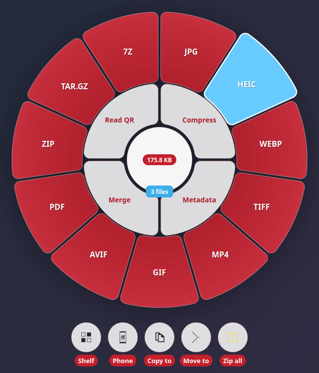
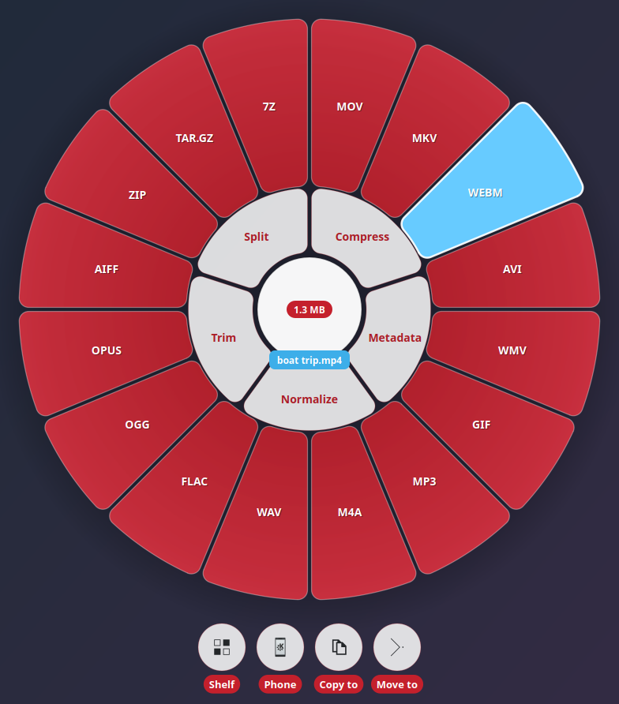
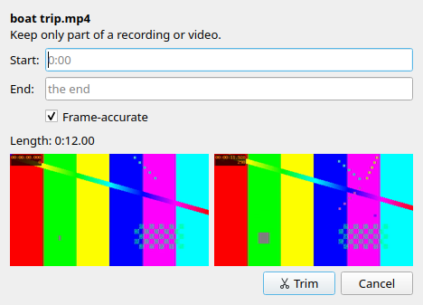
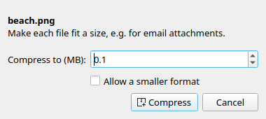
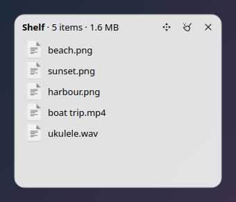
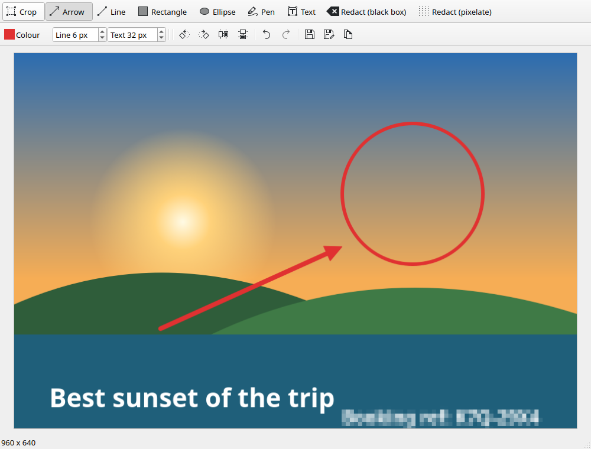
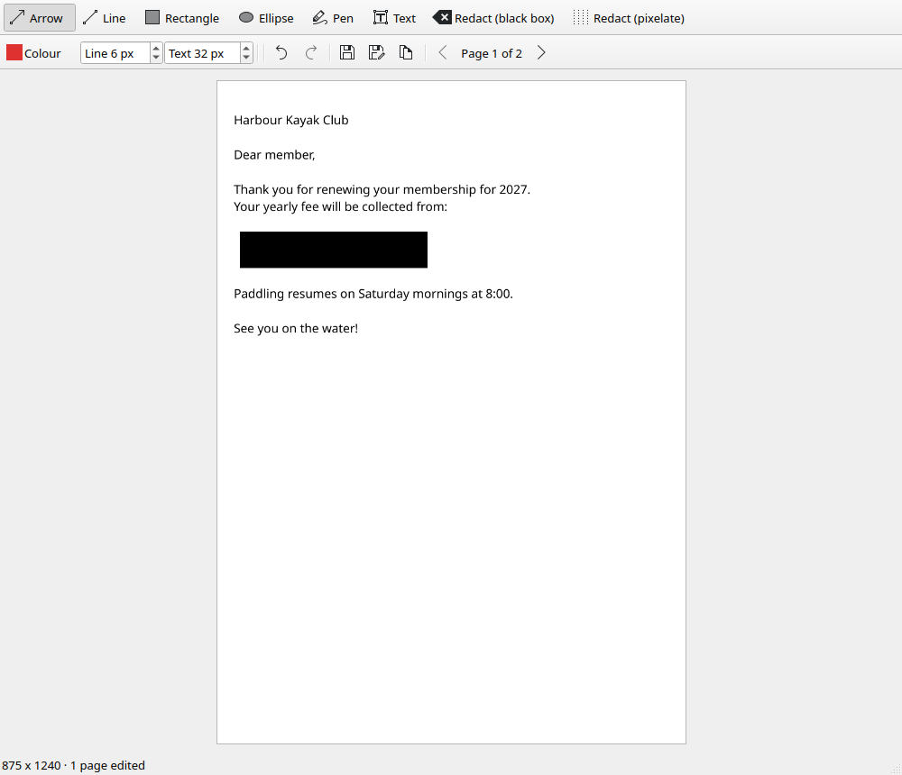

<p align="center">
  
</p>

<h1 align="center">Hala</h1>

<p align="center">
  <a href="https://github.com/baverrr/hala-v2/actions/workflows/codeql.yml"></a>
</p>

A local file converter for Linux desktops, made on KDE Plasma. Drag files to the edge of the screen, pick a format on
a wheel, and the results appear next to the originals. It also compresses files to a size,
strips metadata, merges and splits PDFs, reads QR codes, trims and joins video and audio,
holds files on a floating shelf, and crops, annotates and redacts pictures and PDFs.

Everything happens on your own computer, using ffmpeg, libvips, LibreOffice, pandoc, poppler,
qpdf, Ghostscript, exiftool, zbar and 7-Zip. Nothing is uploaded anywhere.

Hala is named after the hala fruit (*Pandanus tectorius*), which grows across the Pacific.

<p align="center">
  
</p>

> [!IMPORTANT]
> **Disclaimer.** Hala is provided as is, without warranty, and you use it at your own risk
> (see the [Terms and Conditions](TERMS.md)).
>
> - **Keep backups of anything important.** Hala never overwrites the original, but
>   conversions can lose quality, formatting or metadata, and **Move to** removes files from
>   their old place.
> - **Check redactions before sharing.** Pixelating small text may not hide it completely;
>   use the black box for anything sensitive. In a PDF, only the pages you edited are
>   flattened; the other pages keep their text and anything hidden in them.
> - **Check metadata before sharing.** Conversions keep metadata, such as where a photo was
>   taken, wherever the new format can hold it. The **Metadata** tool removes it.
> - **Only convert files you have the right to copy or change.**
> - **Some formats are patent-encumbered** in some countries (for example HEIC/HEVC, H.264 and
>   AAC). Whether you may use them is up to you and the rights holders.
> - **The converters are separate programs** (ffmpeg, LibreOffice, pandoc…). Hala doesn't
>   bundle them, and each one keeps its own license.
> - **Trademarks:** KDE, Plasma and Dolphin are trademarks of KDE e.V.; Microsoft Word, Excel
>   and PowerPoint of Microsoft; Pages, Numbers and Keynote of Apple; Ubuntu of Canonical.
>   They're named only to say what Hala works with. Hala isn't affiliated with, endorsed or
>   sponsored by any of them.

## Contents

- [Features](#features)
- [Install](#install)
- [Getting started](#getting-started)
- [Using Hala](#using-hala): [the wheel](#the-drop-zone-and-the-wheel) ·
  [Dolphin](#dolphin-right-click-menus) · [tools](#tools) · [actions](#actions) ·
  [shelf](#the-shelf) · [picture editor](#the-picture-editor) · [command line](#command-line)
- [Supported formats](#supported-formats)
- [How it works](#how-it-works)
- [Safety](#safety)
- [Known limitations](#known-limitations)
- [Development](#development)
- [Privacy and terms](#privacy-and-terms)

## Features

- **Convert by dragging.** A thin strip on the screen edge opens a full-screen wheel of every
  format the dragged files can become. Drop on a petal and you're done. It works across
  several monitors.
- **…or without dragging.** Right-click files in Dolphin → **Hala…**, or copy them (Ctrl+C)
  and press **Meta+Shift+H**: the same wheel opens where the pointer is.
- **Convert from Dolphin.** Right-click → **Convert to** lists exactly the formats a file (or a
  selection of files) can become. **Hala tools** holds the tools and the editor.
- **Around 70 input formats:** images (including HEIC, AVIF, WebP, JPEG XL and SVG), video,
  audio, subtitles, Word/Excel/PowerPoint and their LibreOffice and Apple counterparts,
  Markdown, HTML, e-books and notebooks, PDF, and archives (zip, 7z, rar, tar.*).
- **Tools:** compress to a target size, remove or set metadata, merge, split and unlock PDFs, read QR
  codes and barcodes, normalize loudness, trim, split and join video and audio.
- **Actions:** put files on the shelf, send them to your phone with KDE Connect, copy or move
  them to a folder, or zip them all, from bubbles under the wheel.
- **Shelf:** a small floating window that holds files until you drag them somewhere else.
- **In your language:** English, German, Spanish, French and Brazilian Portuguese, following
  the desktop's language setting.
- **Picture and PDF editor:** crop (with aspect presets), rotate, flip, arrows, lines,
  shapes, freehand, text, and redaction by black box or pixelation, with undo. PDFs are
  edited page by page, and edited pages are flattened so the text underneath is really gone.
  It always saves a copy.
- **Desktop-native feedback:** progress appears in Plasma's job tracker (elsewhere, in a
  notification) with a working Cancel button, and a notification offers **Open** or **Show in
  folder** when the work is done.
- **Never overwrites anything.** Results go next to the originals as `name.ext`, or
  `name (2).ext` if that's taken.
- **Gentle on the desktop.** Work runs at low CPU and disk priority, two files at a time.

## Install

Hala is made for **Kubuntu 25.04 or later, or Ubuntu with KDE Plasma 6** (Wayland). It's built
and tested on Ubuntu 26.04 with Plasma 6.6. It also runs on GNOME, Cinnamon, Xfce, MATE and
wlroots compositors (Sway, Hyprland…), on Wayland or X11: see [Other desktops](#other-desktops).

### From the release (recommended)

Download `hala_0.4.0_all.deb` from the
[latest release](https://github.com/baverrr/hala-v2/releases/latest), then:

```bash
sudo apt install ./hala_0.4.0_all.deb
```

apt also installs the converters Hala needs: ffmpeg, libvips, poppler, 7-Zip, qpdf,
Ghostscript, exiftool, zbar and zstd. It recommends LibreOffice (office documents) with the
Carlito and Caladea fonts (so Word and PowerPoint files keep their layout), pandoc and
WeasyPrint (Markdown, HTML, e-books, and PDFs from them), wl-clipboard (the shortcut), KDE
Connect (sending to a phone) and kdialog. Those come along unless you install with
`--no-install-recommends`.

Check that everything is there with:

```bash
hala doctor
```

To uninstall: `sudo apt remove hala`.

### From source

```bash
git clone https://github.com/baverrr/hala-v2.git hala
cd hala
python3 packaging/build_deb.py --release      # makes dist/hala_0.4.0_all.deb
sudo apt install ./dist/hala_0.4.0_all.deb
```

The package installs the `hala` command, the application-menu entry and icon, and the Dolphin
menus for every account on the computer.

## Getting started

1. Open **Hala** from the application launcher. A thin strip appears on the right edge of
   each screen, and Hala's icon appears in the system tray.
2. Drag a file (from Dolphin, the desktop, a browser download list…) to the strip. The wheel
   opens.
3. Keep dragging onto a format and let go.

The converted file appears next to the original, and a notification lets you open it or show
it in its folder.

To start the drop zone every time you log in:

```bash
hala dropzone --autostart on       # --autostart off to stop; --edge left for the left edge
```

The tray icon's menu can **Hide drop zone** (if the strip is in the way), **Show shelf**, open
the **Wheel for copied files**, and **Quit**.

### Without dragging to the edge

Wayland doesn't let an app see a drag until it reaches one of the app's own windows, which is
why the strip exists. Two other ways open the same wheel, in click mode, wherever the pointer
is:

- **Right-click files in Dolphin → Hala…** (or in GNOME Files, Caja, Nemo or Thunar: see
  [Other desktops](#other-desktops)).
- **Copy files (Ctrl+C in Dolphin or most file managers), then press Meta+Shift+H.** To change
  the key, look for **Hala wheel** in System Settings › Keyboard › Shortcuts. The shortcut is
  set up the first time you log in after installing. On GNOME it's added the first time the
  drop zone starts, under Settings › Keyboard › Custom Shortcuts.

Click a petal or bubble to pick, or click outside the wheel or press **Esc** to cancel.

## Using Hala

### The drop zone and the wheel

<p align="center">
  
</p>

The wheel shows only what makes sense for the files you're dragging:

- **Red petals (outer ring):** formats every dragged file can become. Several files at once
  are converted together. A video offers audio formats too, which extracts its sound track.
- **White petals (inner ring):** [tools](#tools) that take these files. Tools that need
  settings open a small dialog first.
- **Centre:** the total size, and the file name or count.
- **Bubbles (below the wheel, or above it near the bottom of the screen):** [actions](#actions).

Hovering a petal or bubble lights it up. Drop on empty space, drag off the screen, or press
**Esc** to cancel. If a drop lands on the strip itself, the wheel stays open and you pick by
clicking instead.

### Dolphin right-click menus

Select one or more files in Dolphin and right-click:

- **Convert to ›** lists the formats for that file type. With several files of the same kind
  selected (all pictures, say), it lists the formats for the whole selection, and files
  already in the chosen format are skipped.
- **Hala tools ›** holds the tools that take the selection, **Crop, annotate, redact…** for
  pictures and PDFs, and **Put on shelf** for anything.

Conversions started from Dolphin show progress in Plasma's job tracker. Cancel stops them
cleanly, and no half-written files are left behind.

### Other desktops

Plasma is where Hala is at home, but everything works elsewhere, with the desktop's own
equivalents. `hala doctor` shows what Hala found.

| | Plasma | wlroots (Sway, Hyprland…) | GNOME (Wayland) | X11 (Xfce, MATE, Cinnamon…) |
|---|---|---|---|---|
| Drop zone, wheel, shelf | layer shell | layer shell | through XWayland | always-on-top windows |
| Progress and Cancel | job tracker | notification | notification | notification |
| Right-click **Hala…** | Dolphin (full menus) | your file manager below | GNOME Files | Caja, Nemo, Thunar |
| Shortcut for copied files | set up for you | bind it yourself | set up for you | bind it yourself |
| Clipboard | wl-clipboard | wl-clipboard | wl-clipboard | xclip or xsel |

- **Right-click entries.** GNOME Files and Caja get **Hala…** and **Crop, annotate, redact…**
  through their Python extensions (`sudo apt install python3-nautilus` or `python3-caja`, then
  restart the file manager); Nemo through Nemo actions; Thunar through custom actions, added
  to your own list by `hala install-menus` (start Thunar once first). Only Dolphin gets the
  full **Convert to** menus; elsewhere **Hala…** opens the wheel with everything on it.
- **Binding the shortcut yourself:** bind `hala wheel --clipboard` to a key in your desktop's
  keyboard settings (or Sway/Hyprland config).
- **On GNOME** the strip and wheel run as X11 windows, because GNOME doesn't let Wayland apps
  place windows on the screen edge. Dragging from Wayland apps onto them works as usual. The
  tray icon needs the AppIndicator extension (Ubuntu has it).
- **On X11** a window manager that ignores "always on top" can hide the strip behind other
  windows.

### Tools

<p align="center">
  
  &nbsp;&nbsp;
  
</p>

| Tool | What it does | Takes |
|---|---|---|
| **Compress** | Makes each file fit a size, e.g. 5 MB for an email, trying the best-looking way first. Pictures (PNG, TIFF and BMP become JPG, with transparency made white): the highest quality that fits, then without their metadata, then smaller. Video: a two-pass encode, lowering resolution (down to 360p), frame rate and sound as the size shrinks, and redone smaller if it overshoots. Audio (WAV, FLAC and other lossless sound become M4A): a lower bit rate, mono when it's low. PDFs: a lossless repack first, then Ghostscript presets, then lower picture resolutions. **Allow a smaller format** lets pictures become WebP and sound become Opus (down to 12 kb/s) when that's what fits. | pictures, video, audio, PDF |
| **Metadata** | Removes **everything**, or only the **location**, or nothing. It can also set title, author and comment. Picture orientation and colour profile are kept. | pictures, PDF, video, audio |
| **Merge PDF** | One PDF from several PDFs and/or pictures, in the order you choose in the dialog. | PDF, pictures (2+) |
| **Split PDF** | One PDF per page, or per range (`1-3, 5, 8-`). | PDF |
| **Unlock PDF** | A copy without the password (typed into a masked field, never put on a command line or in a log), or, for a PDF that opens without one, without its limits on printing and copying. Other PDF tools say when a file needs unlocking first. | PDF |
| **Read QR** | Decodes QR codes and barcodes into a text file, shows the text in the notification, with a **Copy** button. | pictures, PDF |
| **Normalize** | Evens out loudness to a target (−14 LUFS streaming, −16 podcasts, −23 broadcast) in two passes. | audio, video |
| **Trim** | Keeps the part between a start and end time, with frame previews. **Frame-accurate** re-encodes for an exact cut; off, it's instant but cuts at a keyframe. Can also remove silence at the start and end. | video, audio |
| **Split** | Cuts into *N* equal parts or pieces of a fixed length. | video, audio |
| **Join** | One file from several, in the order you choose. Matching files are joined without re-encoding. | video or audio (2+) |

Results are saved next to the originals with a suffix, e.g. `report (compressed).pdf` or
`talk (trimmed).mp4`.

### Actions

| Bubble | What happens |
|---|---|
| **Shelf** | The files go on the [shelf](#the-shelf). |
| **Phone** | Sends the files to a phone paired with [KDE Connect](https://kdeconnect.kde.org/). If more than one phone is reachable, Hala asks which. A folder is sent as a `.zip` of it. |
| **Copy to / Move to** | Asks for a folder and copies or moves the files there. Nothing is ever overwritten, links are kept as links, and a move between drives deletes the original only after the copy is complete. |
| **Zip all** | One `.zip` of everything you dragged (shown for two or more items; for one, use the ZIP petal). |

### The shelf

<p align="center">
  
</p>

The shelf is a small window in the top-right corner that holds files while you go and find
where they should go. Drop files on it (or use the **Shelf** bubble, Dolphin's **Put on
shelf**, or the tray's **Show shelf**). Then drag one, a selection, or everything (the
four-arrow button) into any app. Files stay on the shelf after a drag. If a file is moved or
deleted elsewhere, it drops off on its own. Right-click an item to open it, show it in its folder, or
remove it. Only one shelf runs at a time; sending more files adds them to it.

### The picture editor

<p align="center">
  
</p>

Open it with **Hala tools › Crop, annotate, redact…** in Dolphin, or `hala edit FILE...` for
pictures and PDFs.

- **Crop** by dragging, with aspect presets (free, 1:1, 4:3, 16:9…). Press **Enter** to apply.
- **Arrow, Line, Rectangle, Ellipse, Pen, Text** in any colour and line or text size.
- **Redact** with a solid black box or by pixelating. Redactions are burned into the pixels of
  the saved copy and can't be undone from the file.
- **Rotate and flip**, plus **Undo / Redo** for everything.
- **Save copy** writes `name (edited).ext` beside the original, which is never touched.
  **Save as…** picks a name and format, and **Copy** puts the picture on the clipboard.

Saved copies carry no metadata from the original (no location, camera or edit history). The
orientation is applied to the pixels instead.

<p align="center">
  
</p>

**PDFs** open page by page (◀ **Page n of m** ▶, or Page Up / Page Down), with the drawing
and redaction tools, crop, rotate and flip. Each page keeps its own edits and undo history.
**Save copy** writes `name (edited).pdf`:

- **Pages you edited are flattened into pictures,** so text under a black box (or cut off by
  a crop) can't be selected, searched or copied out of the file. That's what makes the
  redaction real, but it also means those pages' text is no longer selectable. A cropped page
  becomes the size of what you kept.
- **Pages you only rotated are turned, not redrawn,** so they keep their text and links.
- **Pages you didn't touch are kept exactly as they were**, text and all.
- **The original's metadata, bookmarks and attached files aren't carried over**, because
  they're common places for the information you meant to remove. Form fields and links on
  pages you didn't edit are kept.

A password-protected PDF asks for its password when it opens. The edited copy opens without
one; the original keeps its password.

### Command line

Everything is also available from a terminal:

```bash
hala targets photo.heic                  # what can it become?
hala convert -t jpg *.heic               # convert, results beside the originals
hala convert -t mp3 -o ~/Music talk.mp4  # ...or into another folder
hala convert -t folder backup.7z         # extract an archive
hala tool                                # list the tools
hala tool compress --size 5 video.mp4    # each tool's options: hala tool NAME --help
hala tool compress --size 1 --reformat talk.mp3   # may become Opus to fit
hala tool metadata --remove location *.jpg
hala tool trim --start 0:05 --end 1:30 clip.mp4
hala tool split-pdf --pages "1-3, 5" scan.pdf
hala tool unlock statement.pdf           # asks for the password
hala tool metadata --show photo.jpg      # print a file's title, author, location...
hala shelf [FILES]                       # open the shelf, optionally with files
hala action zip|copy|move|phone|shelf FILES
hala edit PICTURE-OR-PDF...
hala wheel FILES | --clipboard           # the wheel without dragging to the edge
hala formats                             # the whole conversion table
hala limits [set NAME N | reset [NAME]]  # show or change the size limits
hala doctor                              # check the converters are installed
```

`hala convert` and `hala tool` print one line per file, or JSON with `--json`, and run two
files at a time (`-j N` to change that). Anything worth knowing about a result that still
worked, such as pictures a document had to leave out, follows as a `note:` line.

## Supported formats

| Kind | Reads | Writes |
|---|---|---|
| Pictures | JPG, PNG, HEIC, WebP, TIFF, BMP, GIF, AVIF, SVG, JPEG XL | JPG, PNG, HEIC, WebP, TIFF, GIF, AVIF, PDF, MP4 (a still held for 5 s, or an animation played) |
| Video | MP4, MOV, MKV, WebM, AVI, WMV, M4V, FLV, MPG, 3GP, TS, MTS | MP4, MOV, MKV, WebM, AVI, WMV, GIF, and the audio formats |
| Audio | MP3, M4A, AAC, WAV, FLAC, OGG, Opus, AIFF, WMA, MKA | MP3, M4A, WAV, FLAC, OGG, Opus, AIFF |
| Subtitles | SRT, VTT, ASS, SSA | SRT, VTT, ASS |
| Documents | DOCX, DOC, ODT, RTF, Pages, WPD, TXT | PDF, DOCX, ODT, RTF, TXT (DOCX/ODT also to Markdown, HTML, EPUB) |
| Spreadsheets | XLSX, XLS, ODS, CSV, Numbers | PDF, XLSX, ODS, CSV |
| Presentations | PPTX, PPT, ODP, Keynote | PDF, PPTX, ODP |
| Markup and e-books | Markdown, HTML, EPUB, reStructuredText, Org, LaTeX, Jupyter notebooks | Markdown, HTML, EPUB, DOCX, ODT, TXT, PDF |
| PDF | PDF | PNG or JPG (one per page), TXT |
| Archives | ZIP, 7Z, RAR, TAR, TAR.GZ, TAR.BZ2, TAR.XZ, TAR.ZST, GZ | the extracted folder, ZIP, TAR.GZ, 7Z |
| Anything (including folders) | | ZIP, TAR.GZ, 7Z |

A multi-page PDF turned into pictures gives a folder with one picture per page. A video
becomes audio by extracting its first sound track. `hala formats` prints the exact table.

## How it works

| Files | Engine |
|---|---|
| Pictures | libvips (`vips`). EXIF rotation is applied, CMYK becomes sRGB, and transparency is flattened onto white for JPG. Pictures to PDF go through Hala's own small PDF writer. |
| Video, audio, subtitles | ffmpeg. When the target container can hold the existing codecs, the file is rewrapped without re-encoding, which is fast and lossless. |
| Office documents | LibreOffice in headless mode, with private profiles of its own: one per worker, so two documents convert at once. |
| Markup and e-books | pandoc. PDFs are made from HTML by WeasyPrint with Hala's print stylesheet (page numbers, readable type, tables, code), and it may only open pictures and fonts in the document's own folder; without WeasyPrint they go through DOCX and LibreOffice. No LaTeX is needed. |
| PDF | poppler (pages to pictures or text), qpdf (merge, split, unlock, metadata, saving edited PDFs, the lossless repack in Compress), Ghostscript (compression). |
| Metadata | exiftool for pictures and PDF; an ffmpeg stream copy for audio and video. |
| QR codes | zbar. |
| Archives | 7-Zip, Python's tarfile, GNU tar (for .tar.zst) and zipfile. |
| Desktop | Qt for Python (PySide6) for the wheel, dialogs, shelf and editor; layer-shell-qt to place the strip and wheel on Wayland; D-Bus for Plasma's job progress, notifications and the file manager. |

Each job works in a hidden scratch folder (`.hala-…`) beside its output and moves the result
into place only when it's complete. The name is claimed atomically first, so two jobs
finishing at once can't overwrite each other.

## Safety

Files come from anywhere, so Hala treats them as untrusted:

- Documents can't pull other files into the output. pandoc parses inside its sandbox, so
  include directives can't read files, and only pictures inside the document's own folder (or
  below it, but not in hidden folders like `.ssh`) are embedded, never absolute paths, `../`
  paths, web addresses or other kinds of file.
- A "picture" must really be one: Hala checks its bytes before any decoder sees it, so a script
  renamed `photo.jpg` never reaches ImageMagick or Ghostscript.
- LibreOffice runs with macros and external links switched off, and ffmpeg may open only local
  files.
- Archives can't write outside their folder: `../` paths and links that point outside are
  refused.
- **No zip bombs, either way.** An archive that would unpack to more than 100 times its size
  (once past 1 GB), holds over 100,000 entries, or won't fit in the free space is refused before
  anything is written. Hala won't *make* one either: sparse files (huge on paper, empty on
  disk) aren't packed, and an archive that would unpack to that ratio is thrown away.
- Jobs check for free space first (twice the input), and pictures over 500 megapixels are
  refused.
- **You can change those limits** for very large but legitimate inputs: `hala limits` shows
  them, and `hala limits set max_megapixels 2000` (or `max_archive_entries`,
  `max_unpack_ratio`, `unpack_floor_gb`) changes one. They're kept in
  `~/.config/hala/limits.conf` and take effect at the next job, even in a running drop zone.
  Each has a ceiling, so a typo can't switch a check off, and a refusal names the setting to
  raise.
- Nothing is ever overwritten, and every program gets full, absolute paths, so a file named
  `-rf` is just a file name.

The full review is in [docs/review-2026-10-21-security.md](docs/review-2026-10-21-security.md),
and [CodeQL](https://codeql.github.com/) scans every push.

## Known limitations

- **Tested day to day on Plasma only.** Other desktops ([what differs](#other-desktops)) are
  covered by the automated tests and a check on X11, not yet by daily use. Only Dolphin gets
  the full **Convert to** menus; other file managers get **Hala…**, which opens the wheel.
- **No "hold Shift while dragging anywhere".** Wayland doesn't let apps watch drags that start
  in other apps. Drag to the strip at the screen edge, or use [Hala… or the
  shortcut](#without-dragging-to-the-edge) instead.
- **Ubuntu/Debian package only.** Other distributions can run it from source if they have the
  same tools and Qt for Python, but only the `.deb` is built and tested.
- **Office conversions are as good as LibreOffice.** Complex layouts, unusual fonts and Apple
  Pages/Numbers/Keynote files may not come out exactly as they look in the original app. The
  recommended Carlito and Caladea fonts fix the most common problem, Calibri and Cambria text
  reflowing.
- **No typeset maths in markup PDFs.** They get Hala's print style (page numbers, tables, code
  blocks), but LaTeX maths stays as plain text. Without WeasyPrint they go through Word format.
- **Pictures in documents must sit in the document's folder** (or below it) to be embedded.
  Absolute paths, `../` paths and web images are left out on purpose, as their alt text, and
  the result's notification says which ones.
- **Compress has a floor.** If even its last step doesn't reach the size you asked for, it says
  how small the file can get instead of producing a bad result. Pictures that aren't already
  JPG, WebP, HEIC or AVIF (PNG, TIFF, BMP…) always come out as JPG, and sound that isn't MP3,
  M4A, OGG or Opus always comes out as M4A; **Allow a smaller format** also lets pictures
  become WebP and sound become Opus. Video always comes out as an H.264 MP4 with one picture
  and one sound track (a WebM or MKV becomes an MP4, and extra sound and subtitle tracks are
  left out). The result's notification says when any of this happened.
- **Edited PDF pages become pictures.** Their text can't be selected or searched any more, and
  their links and form fields are gone (unedited pages keep all of theirs). The saved copy has
  no bookmarks, attached files or document metadata. (Pages that were only rotated keep
  their text.)
  Saved copies are flat, so there are no layers to go back to.
- **Phone sending needs KDE Connect** with a paired phone on the same network.
- **The newest parts have had the least real-world use:** the shelf, the action bubbles,
  phone sending, the wheel shortcut and PDF editing. They're tested, but mostly offscreen,
  not yet in daily use like the converter.
- **Size limits are set ahead of time, not asked about.** A picture over 500 megapixels or
  an archive of mostly empty disk images is refused with the setting to change (`hala limits
  set …`), rather than Hala asking at that moment.
- **English only.**

## Development

```bash
python3 -m venv --system-site-packages .venv    # PySide6 and PyGObject come from apt
.venv/bin/pip install -e . pytest ruff
.venv/bin/python -m pytest -q                   # ~460 tests, about 2–3 minutes
.venv/bin/ruff check .
hala install-menus                              # Dolphin menus + app entry for this checkout
python3 tools/screenshots.py                    # re-render docs/*.png offscreen
python3 packaging/make_icon.py                  # regenerate the icon
python3 packaging/build_deb.py [--install]      # build (and install) a timestamped .deb
```

The tests convert real sample files with the real tools (LibreOffice tests are marked
`office`). The GUI tests run offscreen.

| Path | What's there |
|---|---|
| `hala/cli.py` | the `hala` command |
| `hala/registry.py`, `formats.py` | the conversion table |
| `hala/convert.py`, `runner.py`, `jobs.py` | scratch folders, safe placement, running tools, the job queue |
| `hala/limits.py` | size, free-space and zip-bomb limits |
| `hala/engines/` | images, media, documents, PDF, archives |
| `hala/tools/` | compress, metadata, PDF, QR, media edits, zip |
| `hala/actions.py`, `desktop.py` | copy/move/phone actions; progress and notifications |
| `hala/session.py`, `filemanagers.py`, `shortcut.py` | which desktop this is; other file managers' entries; the GNOME shortcut |
| `hala/editing.py` | the editor's document model, PDF pages and saving |
| `hala/gui/` | drop zone, wheel, dialogs, shelf, editor, layer-shell bindings |
| `hala/servicemenus.py` | the generated Dolphin menus and app entry |
| `hala/i18n.py`, `hala/locale/` | translations: the gettext catalogues and how they're loaded |
| `packaging/` | the `.deb` builder and the icon generator |
| `tools/i18n.py` | extracting strings and updating the translations |

### Translations

Hala speaks English, German, Spanish, French and Brazilian Portuguese. It follows the desktop's
language (`LANGUAGE`, then `LC_ALL`, `LC_MESSAGES`, `LANG`); `HALA_LANGUAGE=de` overrides it
for Hala alone, and `HALA_LANGUAGE=C` keeps it English. The Dolphin menus and app entry carry
every language at once, so they follow the language of whoever is logged in. Qt's own buttons
(Save, Cancel...) come from Qt's translations. The first translations are machine-written
drafts, waiting for a native speaker's review.

The text lives in plain gettext catalogues, `hala/locale/<lang>.po`, which Hala reads
directly: there's no compile step, and any `.po` editor (Lokalize, Poedit) or Weblate works on
them. In the code, text is wrapped in `_()` (or `ngettext()` for plurals); text defined once
and shown later, like a tool's label, is marked with `N_()` and passed through `_()` where it's
shown. Placeholders are named, `_("{name} is already {format}").format(...)`, so translators
can move them. With `gettext` installed (`apt install gettext`):

```bash
python3 tools/i18n.py update       # re-extract hala/locale/hala.pot and merge it into each .po
python3 tools/i18n.py new it       # start a new language, hala/locale/it.po
python3 tools/i18n.py check        # every .po is valid and keeps its {placeholders}
python3 tools/i18n.py stats        # how much of each language is done
```

## Privacy and terms

Hala collects nothing and doesn't connect to the internet. The [Privacy Policy](PRIVACY.md)
lists the few log files it keeps on your computer and what's sent where when you use **Phone**.
Use of Hala is covered by the [Terms and Conditions](TERMS.md).

## Credits

Built on the work of the ffmpeg, libvips, LibreOffice, pandoc, poppler, qpdf, Ghostscript,
ExifTool, zbar, 7-Zip, Qt and KDE projects.
